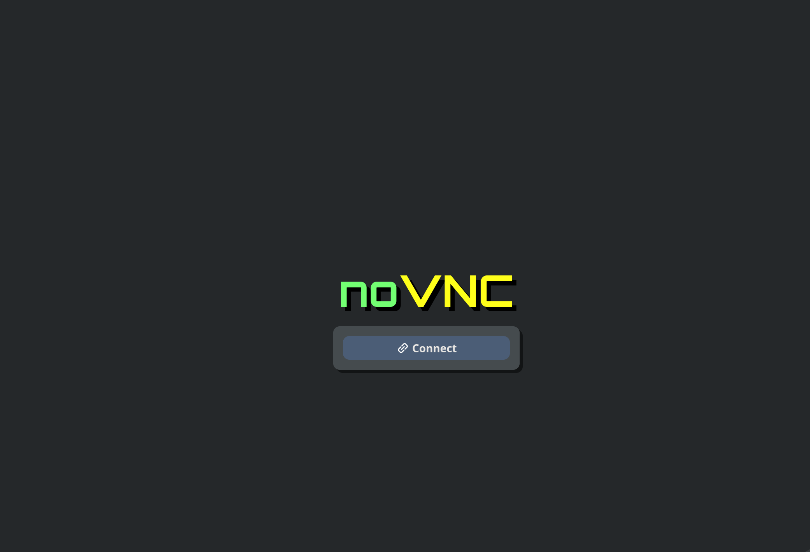
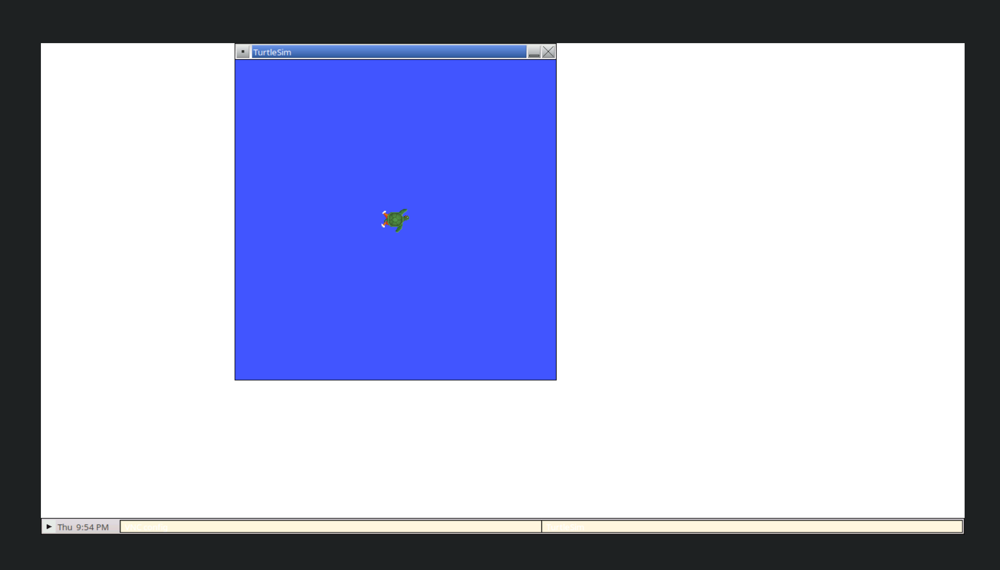

# CAVS Repo Setup

ATTENTION: Read this file before running the scripts.

## Windows

1. Double click on setup.bat to launch the setup script. 
2. This will first install WSL automatically if not already available. Please click yes on any Admin prompts.
3. Next it will install docker desktop, please accept the admin prompt and click through the setup.
4. NEXT, you will have to restart from the docker desktop setup. This is normal and the script will relaunch when your system reboots.
5. When the script launches again on startup, it will install VSCode if not already available and the DevContainers extension.
6. Go to common steps below.

## Mac OS and Linux

WARNING: Do not run the script with sudo and do not run `./install_ros_linux.sh`

1. Open the terminal.
2. Navigate to the cavs_setup_ros directory.
3. Run `./setup.sh`
4. Go to common steps below.

## Common Steps

1. Once this everything is installed, VSCode will be launched with the project folder already open. 
Initial setup will take a while as it installs the ros2 image for the first time. 
2. When the setup is completed, go to your web browser and go to `http://localhost:6080` and you should see a GUI:

3. In the VSCode Container terminal run `ros2 run turtlesim turtlesim_node`
4. You should see a window pop up in the web browser page:

5. You are ready, goodluck :-)
